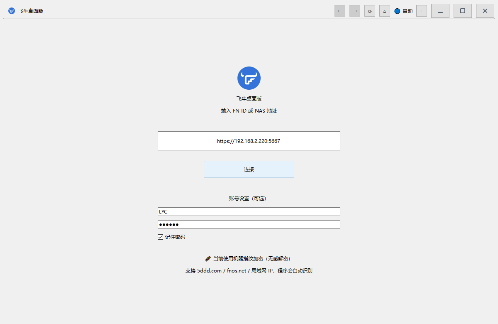
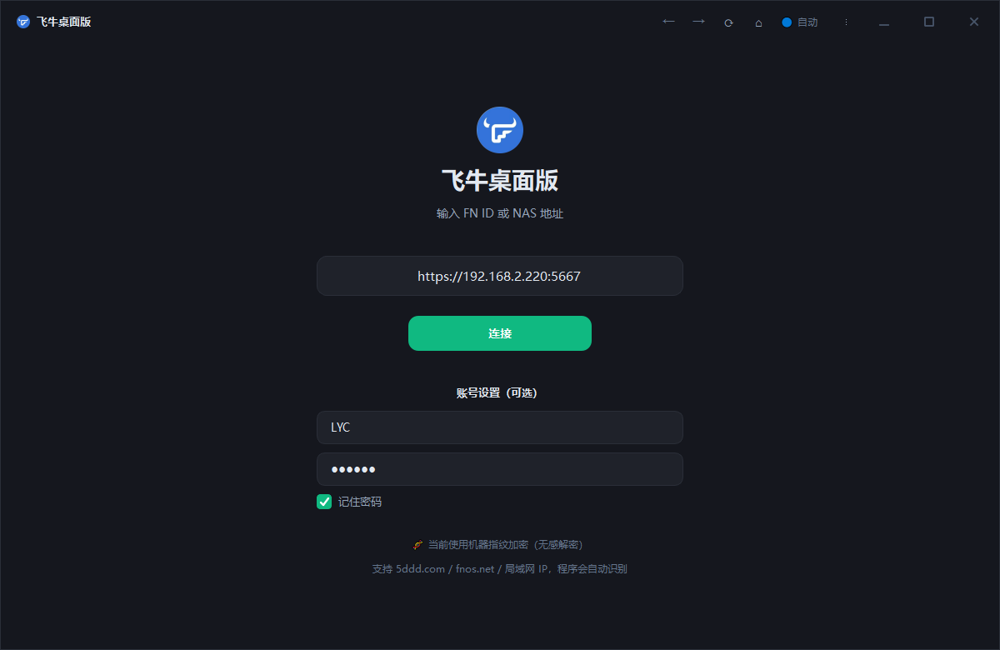
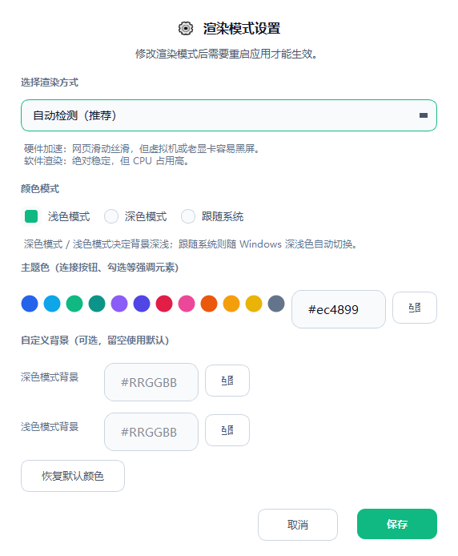

# 飞牛桌面版 (FN Desktop)

> 为 [飞牛 fnOS](https://www.fnos.net) 打造的 Windows 桌面客户端 —— 把 NAS 后台装进一个本地应用里。

[English README](README_EN.md)


---

## 项目简介

**飞牛桌面版**是一个基于 **Python + PySide6 + QtWebEngine (Chromium)** 的飞牛 NAS 桌面客户端。它以"套壳浏览器 + 凭据管理"的方式，将飞牛 fnOS 的网页后台包装成原生 Windows 应用：

- **像原生软件一样**：无边框窗口、自定义标题栏、多套主题、边缘拖拽调整窗口大小；
- **打开即连**：输入 FN ID 或 NAS 地址后自动识别并连接，免去每次手输地址；
- **安全省心**：密码通过本地加密存储，登录页一键自动填充，支持多级加密模式；
- **场景适用**：日常管理飞牛 NAS、SSH/终端入口、应用中心、相册备份等网页后台功能，均可在一个窗口内完成。

---

## 功能特性

| 特性 | 说明 |
| --- | --- |
| 🌐 套壳浏览 | 基于 QtWebEngine (Chromium)，飞牛 fnOS 全部网页功能原生渲染 |
| 🔐 凭据加密 | 5 种加密模式：TPM / Windows 密码 / 自定义密码 / PIN / 机器指纹 |
| 🚀 自动登录 | 检测到登录框后自动填充账号密码并登录 |
| 🛡️ 证书信任 | 内置证书信任管理，自签名证书一键信任（仍保留全局证书校验兜底） |
| 🎨 多主题 | 颜色模式（浅色 / 深色 / 跟随系统）+ 12 种主题色 + 自定义色号 + 自定义背景色 |
| 🔑 记住密码 | 勾选后凭据加密保存，下次自动填充；可随时关闭并清除 |
| 📦 数据本地化 | 配置与凭据保存在程序目录 `data/` 文件夹，重装不丢 |
| 🖱️ 边缘拖拽 | 四边与四角可拖拽调整窗口大小，和普通软件一致 |
| 🔍 白名单填充 | 仅在飞牛相关地址自动填充密码，第三方网页绝不注入 |

---

## 截图

> 截图存放于 `docs/` 目录（当前为真实运行截图）。







---

## 安装步骤

### 环境要求

- Windows 10 / 11（x64）
- Python 3.10 或更高（开发与源码运行；打包版无需 Python）

### 从源码运行

```bash
# 1. 克隆仓库
git clone https://github.com/hbxdss/fn-desktop.git
cd fn-desktop

# 2. 安装依赖（建议使用虚拟环境）
python -m venv .venv
.venv\Scripts\activate
pip install -r requirements.txt

# 3. 运行
python main.py
```

### 使用打包版（无需 Python）

- **免安装版**：解压 `FNDesktop-免安装版-v1.0.0.zip` 后，双击 `FNDesktop.exe` 即可运行（首次启动会在程序目录自动创建 `data/` 配置文件夹）；
- **安装版**：运行 `FNDesktop-安装版-v1.0.0.exe` 安装向导，自动创建桌面与开始菜单快捷方式。

---

## 使用说明

### 连接飞牛

1. 打开应用，在首页输入 **FN ID**（如 `xxxxx.fnos.net`）或 **NAS 局域网地址**（如 `https://192.168.1.100:5667`）；
2. 点击「连接」，程序自动识别地址并打开对应页面；
3. 首次进入管理页面时，如检测到登录框，勾选「记住密码」后程序会保存并自动填充。

> 地址格式支持 `5ddd.com`、`fnos.net` 与局域网 IP:端口，程序会自动识别。

### 切换主题

- 点击标题栏右侧「⋮」菜单 → **设置**；
- **颜色模式**：浅色 / 深色 / 跟随系统（三选一，立即生效）；
- **主题色**：12 种预设色板，或点击色图自由选色 / 输入十六进制色号；
- **背景色**：自定义深色模式 / 浅色模式下的背景颜色。

### 记住密码

- 首页勾选「记住密码」：凭据经加密后保存，下次自动填充；
- 取消勾选：清除已保存的凭据，不再自动填充；
- 该设置持久化保存在 `data/data.json` 中。

### 调整窗口

- 鼠标移至窗口四边或四角，出现高亮热区后按住拖拽即可调整大小；
- 顶部标题栏提供返回 / 前进 / 刷新 / 主页导航与最小化、最大化、关闭按钮。

---

## 配置说明

### 数据目录

所有本地数据位于程序目录下的 **`data/`** 文件夹：

| 文件 | 说明 |
| --- | --- |
| `data/data.json` | 配置与状态（地址、主题、记住密码、凭据加密模式等） |
| `data/trusted_certs.pem` | 已信任的自签名证书列表 |
| `data/*.fnosbak` | 凭据备份文件（导入 / 导出） |

### 加密模式

程序按可用性自动选择最优加密模式，优先级与说明：

| 模式 | 说明 | 触发条件 |
| --- | --- | --- |
| TPM | 使用 Windows TPM 2.0 硬件加密 | 检测到 TPM 2.0 时 |
| Windows 密码 | 使用 Windows 账户密码派生密钥 | 账户已设置密码时 |
| 机器指纹 | 基于本机硬件信息派生密钥，无感解密 | 上述不可用时（默认兜底） |
| 自定义密码 | 用户自设密码加密 | 手动选择 |
| PIN | 使用 Windows PIN 派生密钥 | 手动选择 |

> 当 Windows 账户**未设置密码**时，程序不会弹出「Windows 密码」相关弹窗，而是自动降级到机器指纹 / 自定义密码等可用模式，并明确提示当前使用的模式。

### 凭据导入 / 导出

- **导出**：设置 → 凭据管理 → 导出备份，生成 `.fnosbak` 文件；
- **导入**：选择 `.fnosbak` 文件即可恢复凭据（跨机器导入时请配合自定义密码 / TPM 迁移流程）。

---

## 项目目录结构

```
fn-desktop/
├── main.py              # 程序入口：窗口、主题、证书策略
├── browser.py           # 浏览器主体：导航、自动填充、边缘拖拽、证书信任
├── title_bar.py         # 自定义标题栏（导航 + 窗口控制按钮）
├── config.py            # 主题色板、QSS 生成、资源路径
├── custom_page.py       # QWebEnginePage 定制（证书回调备用）
├── data_store.py        # data/ 配置读写
├── secure_store.py      # 凭据加密（TPM/Windows密码/自定义/PIN/指纹）
├── trust_store.py       # 自签名证书信任管理
├── fn_connect.py        # FN ID 地址识别与连通性探测
├── cert_dialog.py       # 证书信任弹窗
├── password_dialog.py   # Windows 密码 / 自定义密码解锁弹窗
├── migrate_dialog.py    # 凭据迁移弹窗
├── search_dialog.py     # 地址搜索弹窗
├── settings_dialog.py   # 设置（主题 / 凭据 / 关于）
├── keyboard_sim.py      # 键盘事件模拟（自动登录）
├── inject.js            # 页面注入脚本（自动登录、白名单）
├── assets/              # 图标资源（app.ico / app.png 等）
├── docs/                # 文档截图
├── build.spec           # PyInstaller 打包配置
├── setup.iss            # Inno Setup 安装版脚本
├── requirements.txt     # 依赖清单
└── README.md            # 本文档
```

---

## 常见问题 (FAQ)

### 1. 打开后无法连接 NAS，提示证书错误？

程序默认信任自签名证书并提供证书信任弹窗；如仍未生效，请在设置中检查「证书信任」并将证书加入白名单。企业 / 家庭网络使用自签名证书时，请先在管理页完成一次手动信任。

### 2. 密码没有被自动填充？

自动填充仅在**飞牛相关地址**（`*.fnos.net`、`*.5ddd.com` 或用户输入的 NAS 地址，且端口一致）下生效，第三方网页不会注入。若登录框结构特殊，请手动输入一次并勾选「记住密码」。

### 3. 为什么「Windows 密码加密」不可用？

当 Windows 账户未设置密码时，该模式无法使用。程序会自动降级到机器指纹加密（无感解密）或其他可用模式，并在界面明确提示当前模式。

### 4. 数据存在哪里？重装会丢失吗？

所有数据保存在程序目录 `data/` 文件夹。**卸载 / 升级前请先导出 `.fnosbak` 备份**，重新安装后导入即可恢复。

### 5. 打包版启动很慢 / 首次运行需要联网？

首次运行需初始化 Chromium 内核与本地加密密钥，属正常现象。软件渲染模式（虚拟机 / 远程桌面环境）下启动略慢，但不影响使用。

### 6. 支持 Mac / Linux 吗？

当前版本面向 Windows。代码基于 PySide6（跨平台），理论上可移植；Mac 与 Linux 适配版本将在后续发布。

### 7. 如何反馈 Bug 或提需求？

请在 [GitHub Issues](https://github.com/hbxdss/fn-desktop/issues) 提交，附上运行环境（Windows 版本、Python 版本）与复现步骤。

---

## 贡献指南 (CONTRIBUTING)

欢迎任何形式的贡献！

1. **Fork** 本仓库并创建特性分支：`git checkout -b feat/my-feature`；
2. **提交** 清晰的变更描述：`git commit -m "feat: 新增 XX 功能"`；
3. **Push** 并提交 **Pull Request**；
4. 代码风格：遵循 PEP 8，保持最小改动；涉及加密 / 安全逻辑的改动请补充说明；
5. 新增第三方依赖需在 `requirements.txt` 中注明用途。

---

## 许可证

本项目基于 [MIT License](LICENSE) 开源。

---

## 致谢

- [飞牛 fnOS](https://www.fnos.net) —— 优秀的 NAS 操作系统
- [Qt for Python (PySide6)](https://doc.qt.io/qtforpython-6/)
- 所有贡献者与测试用户

**联系方式**：

- 📧 邮箱：[hbxdss@126.com](mailto:hbxdss@126.com) · [hbxdss@qq.com](mailto:hbxdss@qq.com)
- 💬 QQ 群：623230744
- GitHub：[@hbxdss](https://github.com/hbxdss) · 欢迎提 Issue 与 PR
