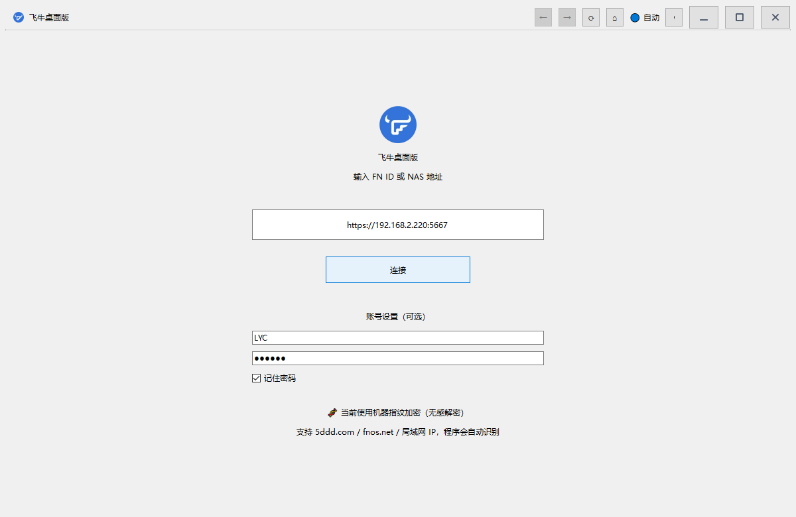
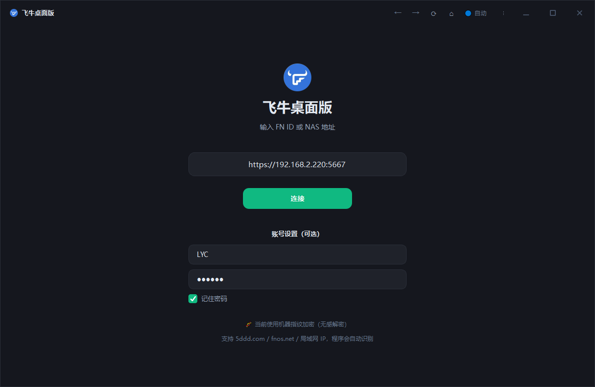
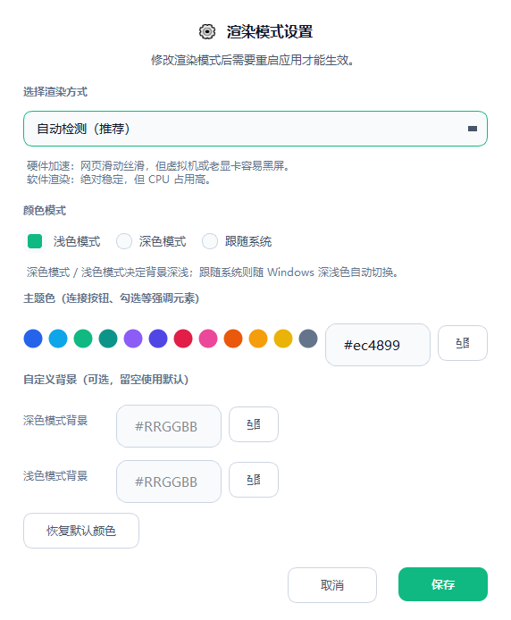

# FN Desktop (飞牛桌面版)

> A Windows desktop client for [FNOS (飞牛 fnOS)](https://www.fnos.net) — put your NAS web console into a native desktop app.

[中文 README](README.md)


---

## Introduction

**FN Desktop** is a desktop client for FNOS NAS built with **Python + PySide6 + QtWebEngine (Chromium)**. It wraps the FNOS web console into a native Windows app using a "shell browser + credential manager" approach:

- **Feels like native software**: frameless window, custom title bar, multiple themes, edge-resize support;
- **Open and connect**: enter your FN ID or NAS address, auto-detect and connect — no more typing addresses every time;
- **Safe and convenient**: credentials are encrypted locally, auto-filled on the login page, with multiple encryption modes;
- **Use cases**: manage your FNOS NAS daily — terminal/SSH, app center, photo backup and all web console features in one window.

---

## Features

| Feature | Description |
| --- | --- |
| 🌐 Shell browser | Renders the full FNOS web console with QtWebEngine (Chromium) |
| 🔐 Encrypted credentials | 5 encryption modes: TPM / Windows password / custom password / PIN / machine fingerprint |
| 🚀 Auto login | Detects the login form and fills credentials automatically |
| 🛡️ Certificate trust | Built-in trust manager, one-click trust for self-signed certificates |
| 🎨 Multi-theme | Color mode (Light / Dark / Follow System) + 12 accent colors + custom hex + custom background |
| 🔑 Remember password | Save encrypted credentials and auto-fill next time; clear anytime |
| 📦 Local data | Config & credentials stored in `data/` next to the program |
| 🖱️ Edge resize | Drag any edge or corner to resize, just like a normal window |
| 🔍 Whitelist autofill | Credentials are only injected on FNOS-related addresses, never on third-party sites |

---

## Screenshots

> Screenshots live in `docs/` (real runtime captures).







---

## Installation

### Requirements

- Windows 10 / 11 (x64)
- Python 3.10+ (only needed to run from source; packaged builds need no Python)

### Run from source

```bash
git clone https://github.com/hbxdss/fn-desktop.git
cd fn-desktop

python -m venv .venv
.venv\Scripts\activate
pip install -r requirements.txt

python main.py
```

### Use the packaged build (no Python required)

- **Portable (免安装)**: unzip `FNDesktop-免安装版-v1.0.0.zip` and double-click `FNDesktop.exe` (a `data/` folder is created automatically on first run);
- **Installer (安装版)**: run `FNDesktop-安装版-v1.0.0.exe` and follow the wizard; desktop & Start-menu shortcuts are created automatically.

---

## Usage

### Connect to FNOS

1. Enter your **FN ID** (e.g. `xxxxx.fnos.net`) or **LAN address** (e.g. `https://192.168.1.100:5667`) on the home page;
2. Click **Connect** — the app detects the address and opens the page;
3. On the login page, check **Remember password** to save credentials and auto-fill next time.

> Supported address formats: `5ddd.com`, `fnos.net`, and LAN `IP:port`.

### Switch themes

- Click the **⋮** menu on the title bar → **Settings**;
- **Color mode**: Light / Dark / Follow System (applies instantly);
- **Accent color**: 12 presets, or pick from the color picker / type a hex value;
- **Background**: customize background for dark & light modes separately.

### Remember password

- Check **Remember password** on the home page: credentials are saved encrypted and auto-filled next time;
- Uncheck to clear saved credentials;
- The setting persists in `data/data.json`.

### Resize the window

- Move the mouse to any edge or corner (a highlight appears) and drag to resize;
- The title bar hosts Back / Forward / Refresh / Home navigation plus minimize, maximize and close buttons.

---

## Configuration

### Data directory

All local data lives in the **`data/`** folder next to the program:

| File | Description |
| --- | --- |
| `data/data.json` | Config & state (address, theme, remember-password, encryption mode, ...) |
| `data/trusted_certs.pem` | Trusted self-signed certificates |
| `data/*.fnosbak` | Credential backups (import / export) |

### Encryption modes

The app auto-selects the best available mode:

| Mode | Description | Condition |
| --- | --- | --- |
| TPM | Hardware encryption via Windows TPM 2.0 | TPM 2.0 detected |
| Windows password | Key derived from the Windows account password | Account has a password |
| Machine fingerprint | Key derived from local hardware info, seamless decrypt | Fallback default |
| Custom password | Encrypted with a user-defined password | Manual choice |
| PIN | Key derived from Windows PIN | Manual choice |

> When the Windows account has **no password**, the app skips the "Windows password" dialog and falls back to fingerprint / custom password, clearly indicating the active mode.

### Backup import / export

- **Export**: Settings → Credentials → Export backup (`.fnosbak`);
- **Import**: pick a `.fnosbak` file to restore credentials (use custom password / TPM migration flow when moving to another machine).

---

## Project structure

```
fn-desktop/
├── main.py              # Entry: window, themes, certificate policy
├── browser.py           # Browser core: navigation, autofill, edge resize, trust
├── title_bar.py         # Custom title bar (nav + window controls)
├── config.py            # Theme palettes, QSS generation, asset paths
├── custom_page.py       # QWebEnginePage customization (cert callback)
├── data_store.py        # data/ config read/write
├── secure_store.py      # Credential encryption (TPM/Windows/Custom/PIN/Fingerprint)
├── trust_store.py       # Self-signed certificate trust
├── fn_connect.py        # FN ID address detection & connectivity
├── cert_dialog.py       # Certificate trust dialog
├── password_dialog.py   # Password/PIN unlock dialog
├── migrate_dialog.py    # Credential migration dialog
├── search_dialog.py     # Address search dialog
├── settings_dialog.py   # Settings (theme / credentials / about)
├── keyboard_sim.py      # Keyboard event simulation (auto login)
├── inject.js            # Page injection script (autofill whitelist)
├── assets/              # Icons (app.ico / app.png ...)
├── docs/                # Screenshots
├── build.spec           # PyInstaller config
├── setup.iss            # Inno Setup installer script
├── requirements.txt     # Dependencies
└── README.md            # This file
```

---

## FAQ

### 1. Cannot connect — certificate error?

The app trusts self-signed certificates with a one-click dialog; if it still fails, check **Settings → Certificates** and add the cert to the whitelist.

### 2. Password is not auto-filled?

Autofill only runs on FNOS-related addresses (`*.fnos.net`, `*.5ddd.com`, or the NAS address you entered with the same port). Third-party sites are never injected. If the login form is unusual, enter once and check **Remember password**.

### 3. Why is "Windows password encryption" unavailable?

When the Windows account has no password, this mode cannot be used. The app falls back to machine fingerprint (seamless) or another available mode and shows the active mode clearly.

### 4. Where is my data? Will I lose it on reinstall?

Everything is in the `data/` folder next to the program. **Export a `.fnosbak` backup before uninstalling/upgrading** and import it after reinstall.

### 5. Slow startup / needs network on first run?

First run initializes the Chromium kernel and local encryption keys — this is normal. Software-rendering mode (VM / remote desktop) starts a bit slower but works fine.

### 6. Mac / Linux support?

Current release targets Windows. The code is PySide6-based (cross-platform in theory); Mac/Linux builds are planned for later releases.

### 7. How to report bugs or request features?

Open an [Issue](https://github.com/hbxdss/fn-desktop/issues) with your environment (Windows version, Python version) and reproduction steps.

---

## Contributing

Contributions are welcome!

1. **Fork** the repo and create a feature branch: `git checkout -b feat/my-feature`;
2. **Commit** with a clear message: `git commit -m "feat: add XXX"`;
3. **Push** and open a **Pull Request**;
4. Style: follow PEP 8, keep changes minimal; document any security/crypto-related changes;
5. New third-party dependencies must be listed in `requirements.txt` with their purpose.

---

## License

Licensed under the [MIT License](LICENSE).

---

## Credits

- [FNOS](https://www.fnos.net) — the great NAS OS
- [Qt for Python (PySide6)](https://doc.qt.io/qtforpython-6/)
- All contributors and testers

**Contact**:

- 📧 Email: [hbxdss@126.com](mailto:hbxdss@126.com) · [hbxdss@qq.com](mailto:hbxdss@qq.com)
- 💬 QQ Group: 623230744
- GitHub: [@hbxdss](https://github.com/hbxdss) · Issues & PRs welcome
